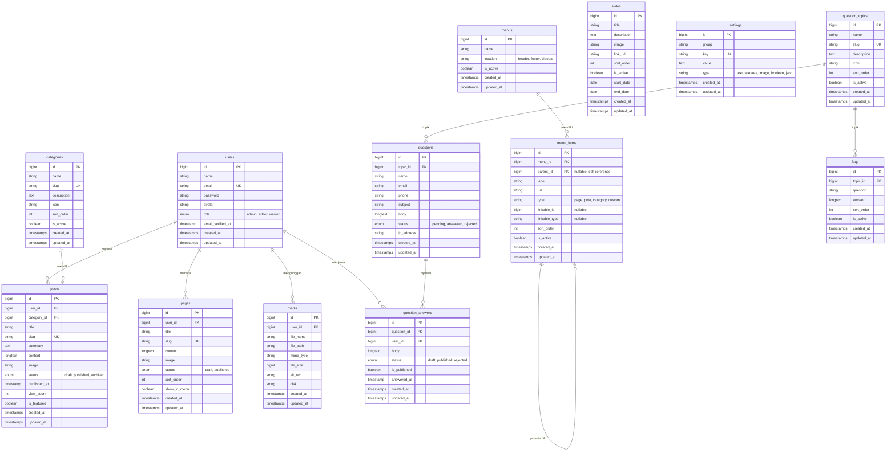
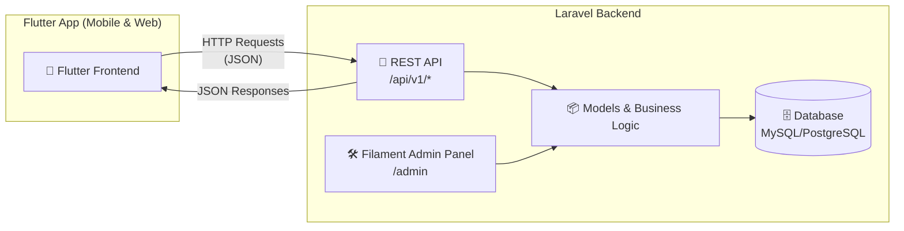

# 📋 Rencana Aksi: Aplikasi CMS & Pertanyaan Masyarakat

> Aplikasi Laravel 13 + Filament v5.11 sebagai backend (Admin Panel + REST API) untuk mengelola konten profil instansi dan menerima pertanyaan dari masyarakat. Frontend publik akan dibangun terpisah menggunakan **Flutter**.

---

## 🗂️ Entity Relationship Diagram (ERD)

---

## 🏛️ Arsitektur Sistem (API-First)

---

## 📦 Status Implementasi

### Fase 1: Fondasi & Konfigurasi ⏱️
- [x] Install Laravel 13 + Filament v5
- [x] Konfigurasi database MySQL (`.env`)
- [x] Setup Filament Admin Panel (tema Emerald, branding "Portal Profil & Layanan")
- [x] Konfigurasi role, permission & avatar pada model User
- [x] Buat migration tabel `settings` & `SettingResource`

### Fase 2: Modul CMS ⏱️
- [x] **Kategori**: Model, Migration, Factory, Seeder, `CategoryResource`
- [x] **Post/Artikel**: Model, Migration, Factory, Seeder, `PostResource` (RichEditor, upload gambar, auto slug)
- [x] **Halaman Statis**: Model, Migration, `PageResource`
- [x] **Media Library**: Model, Migration, `MediaResource` (direct storage upload)
- [x] **Menu & Menu Items**: Model, Migration, `MenuResource` (Repeater nested items)
- [x] **Slide**: Model, Migration, `SlideResource` (jadwal tayang)

### Fase 3: Modul Pertanyaan Masyarakat ⏱️
- [x] **Topik Pertanyaan**: Model, Migration, `QuestionTopicResource`
- [x] **Pertanyaan**: Model, Migration, `QuestionResource`
- [x] **Jawaban Pertanyaan**: Model, Migration, `AnswersRelationManager` di `QuestionResource` (auto-update status `answered`)
- [x] **FAQ**: Model, Migration, `FaqResource`

### Fase 4: REST API untuk Flutter ⏱️
- [x] Install & konfigurasi Laravel Sanctum
- [x] Endpoints REST API v1 lengkap (`/api/v1/*`)
- [x] API Resource formatters (`PostResource`, `MenuResource`, `QuestionResource`, dll)
- [x] Rate limiting throttle pada pengiriman pertanyaan masyarakat
- [x] Storage public symlink (`php artisan storage:link`)
- [x] Automated Test Suite PHPUnit (11 passing tests)
- [x] Code style formatting with Laravel Pint
