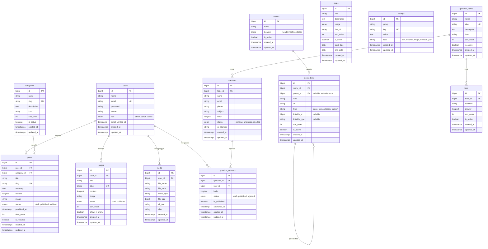
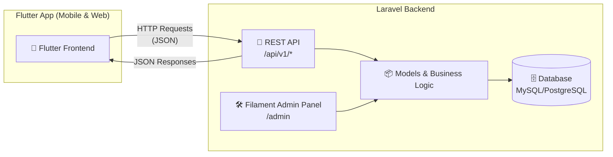

# 📋 Rencana Aksi: Aplikasi CMS & Pertanyaan Masyarakat

> Aplikasi Laravel 13 + Filament v5.11 sebagai backend (Admin Panel + REST API) untuk mengelola konten profil instansi dan menerima pertanyaan dari masyarakat. Frontend publik akan dibangun terpisah menggunakan **Flutter**.

---

## 🗂️ Entity Relationship Diagram (ERD)

---

## 🏛️ Arsitektur Sistem (API-First)

---

## 🏗️ Arsitektur Modul

### Modul 1: CMS (Content Management System)

| Fitur | Deskripsi | Status |
|-------|-----------|--------|
| **Manajemen Post/Artikel** | CRUD artikel dengan kategori, gambar sampul, status draft/publish/archived, rich text editor | ✅ Selesai |
| **Manajemen Halaman Statis** | Halaman seperti "Tentang Kami", "Visi Misi", "Struktur Organisasi" | ✅ Selesai |
| **Manajemen Kategori** | Pengelompokan artikel berdasarkan kategori dengan slug otomatis | ✅ Selesai |
| **Manajemen Media** | Upload & kelola gambar dan berkas lampiran | ✅ Selesai |
| **Manajemen Menu** | Menu navigasi dinamis untuk header, footer, sidebar (Repeater item) | ✅ Selesai |
| **Manajemen Slide** | Slide banner promosi dengan jadwal tanggal tayang | ✅ Selesai |
| **Pengaturan Situs** | Konfigurasi profil instansi, kontak, medsos, dan API | ✅ Selesai |

### Modul 2: Pertanyaan Masyarakat

| Fitur | Deskripsi | Status |
|-------|-----------|--------|
| **Form Pertanyaan Publik** | REST API endpoint untuk masyarakat mengirim pertanyaan (dikonsumsi Flutter) | ✅ Selesai |
| **Topik Pertanyaan** | Kategori topik pertanyaan (pelayanan publik, perizinan, umum) | ✅ Selesai |
| **Manajemen Pertanyaan** | Admin review, jawab, atau tolak pertanyaan masuk | ✅ Selesai |
| **Jawaban Pertanyaan** | Relation Manager jawaban petugas langsung di detail pertanyaan | ✅ Selesai |
| **FAQ** | Kumpulan pertanyaan yang sering diajukan per topik | ✅ Selesai |

---

## 📦 Tahapan Implementasi

### Fase 1: Fondasi & Konfigurasi ⏱️

- [x] Install Laravel 13 + Filament v5
- [x] Konfigurasi database (`.env`)
- [x] Setup Filament Admin Panel (tema Emerald, branding "Portal Profil & Layanan")
- [x] Konfigurasi role, permission & avatar pada model User
- [x] Buat migration untuk tabel `settings`
- [x] Buat `SettingResource` di Filament

### Fase 2: Modul CMS ⏱️

- [x] **Kategori**
  - [x] Buat Model, Migration, Factory, Seeder
  - [x] Buat `CategoryResource` (Filament)
- [x] **Post/Artikel**
  - [x] Buat Model, Migration, Factory, Seeder
  - [x] Buat `PostResource` (Filament) dengan rich text editor & upload gambar
  - [x] Implementasi slug otomatis, featured image, status filter
- [x] **Halaman Statis**
  - [x] Buat Model, Migration, Factory
  - [x] Buat `PageResource` (Filament)
- [x] **Media Library**
  - [x] Buat Model, Migration
  - [x] Buat `MediaResource` dengan direct storage upload
- [x] **Menu & Menu Items**
  - [x] Buat Model, Migration
  - [x] Buat `MenuResource` dengan nested menu items (Repeater)
- [x] **Slide**
  - [x] Buat Model, Migration
  - [x] Buat `SlideResource` (Filament) dengan filter aktif & masa tayang

### Fase 3: Modul Pertanyaan Masyarakat ⏱️

- [x] **Topik Pertanyaan**
  - [x] Buat Model, Migration
  - [x] Buat `QuestionTopicResource` (Filament)
- [x] **Pertanyaan**
  - [x] Buat Model, Migration
  - [x] Buat `QuestionResource` (Filament) dengan filter status
- [x] **Jawaban Pertanyaan**
  - [x] Buat Model, Migration
  - [x] Integrasikan jawaban sebagai Relation Manager (`AnswersRelationManager`) di `QuestionResource`
  - [x] Auto-update status pertanyaan menjadi `answered` saat tanggapan diterbitkan
- [x] **FAQ**
  - [x] Buat Model, Migration
  - [x] Buat `FaqResource` (Filament)

### Fase 4: REST API untuk Flutter ⏱️

- [x] Install & konfigurasi Laravel Sanctum untuk API
- [x] **API Publik (REST API v1)**
  - [x] `GET /api/v1/posts` — Daftar artikel (pagination, filter kategori, search, featured)
  - [x] `GET /api/v1/posts/{slug}` — Detail artikel + otomatis increment view_count
  - [x] `GET /api/v1/pages` & `GET /api/v1/pages/{slug}` — Detail halaman statis
  - [x] `GET /api/v1/categories` & `GET /api/v1/categories/{slug}` — Daftar kategori
  - [x] `GET /api/v1/slides` — Daftar slide banner aktif
  - [x] `GET /api/v1/menus` & `GET /api/v1/menus/{location}` — Menu navigasi (header/footer/sidebar)
  - [x] `GET /api/v1/settings` — Pengaturan situs (profil instansi, kontak, medsos)
  - [x] `GET /api/v1/faqs` — Daftar FAQ publik (filter per topik)
  - [x] `GET /api/v1/question-topics` — Daftar topik pertanyaan
  - [x] `GET /api/v1/questions` & `GET /api/v1/questions/{id}` — Pertanyaan dijawab publik
  - [x] `POST /api/v1/questions` — Kirim pertanyaan baru (validasi + rate limit)
- [x] Buat API Resource classes (`PostResource`, `SlideResource`, `MenuResource`, `QuestionResource`, dll)
- [x] Integrasi storage link (`php artisan storage:link`)
- [x] Unit/Feature Test suite lengkap (11 tests passed, 38 assertions)
